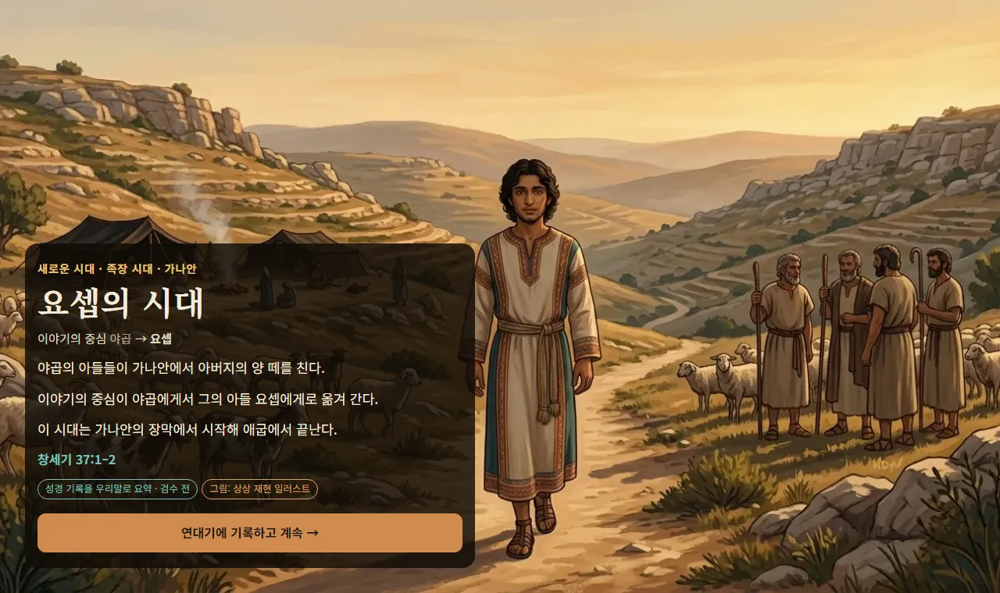
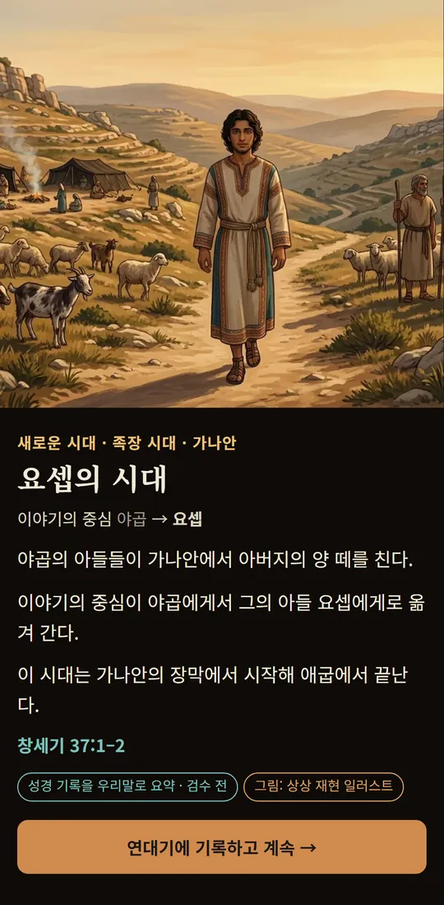
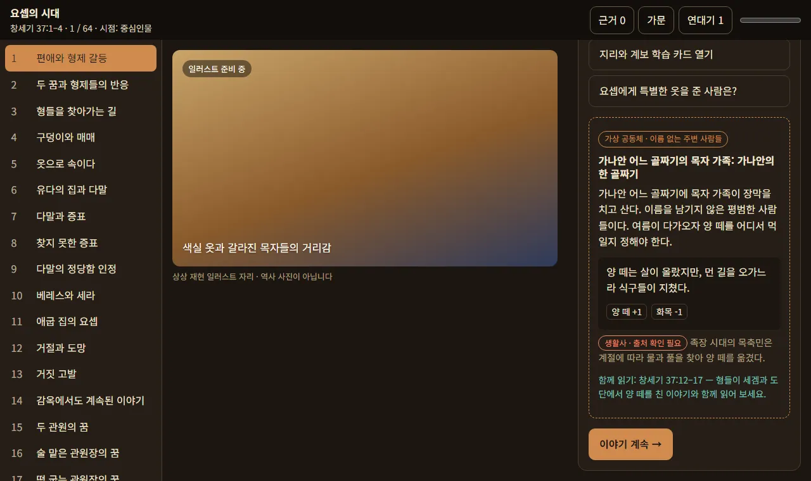

# Bible Chronicle — 성경 역사 문명

> 문명(Civilization)처럼 시대가 흐르고, 나라가 일어서고 무너지고, 주인공이 바뀌는 **성경 기반 게임형 교보재**.
> 이야기는 성경에 기록된 그대로 흐르고, 플레이어의 선택은 **보는 방식·배우는 내용·가상 공동체의 삶**만 바꿉니다.

**[▶ 라이브 데모 — 요셉의 시대 (창세기 37–50장)](https://jeiel85.github.io/bible-chronicle/)** · 개발 미리보기 · 한국어 · PC/모바일 · 오프라인 지원

<p align="center">
  
  
</p>

> ⚠️ **검수 전 초안입니다.** 본문 요약, 해설, 학습 문항, 일러스트는 신학·역사·교육 전문가의 검수를 받기 전입니다. 성경 번역 본문은 사용 허가를 받기 전이라 넣지 않았고, 구절 위치(예: 창세기 37:1–4)로만 안내합니다.

## 무엇을 하는 게임인가

| 문명 게임의 느낌 | Bible Chronicle에서는 |
|---|---|
| 시대의 흐름 | 성경의 선형 서사를 그대로 따라가는 에피소드. 어떤 선택을 해도 결말은 같습니다 |
| 역사적 순간 | 큰 사건마다 전면 일러스트와 내레이션 화면이 뜨고, 본 순간은 **연대기**에 남습니다 |
| 주인공 교대 | 시대가 바뀌면 이야기의 중심도 바뀝니다(야곱 → 요셉 …) |
| 문명 경영 | **이름 없는 가상 가문**의 삶을 꾸립니다. 기근 같은 성경 속 사건은 가문에 영향을 주지만, 가문은 성경 이야기를 바꾸지 못합니다 |
| 시점 | **관찰자**(현대의 나) · **중심인물** · **주변인물** · **제3자**(가상 인물), 네 가지 시점 |
| 학습 | 절별 해설, 근거 카드 도감("성경 기록"과 "외부 사료 입증"을 구분), 복습 퀴즈 |

<p align="center"></p>

## 지키는 원칙

1. **정경 불변**: 성경에 기록된 사건의 결과는 바뀌지 않습니다. 모든 선택 순서에서 결말이 같다는 것을 자동 테스트로 확인합니다.
2. **사실과 창작의 구분**: 성경 기록, 학술 자료, 창작 재구성, 가상 인물에는 각각 다른 표지가 붙습니다. 성경 인물의 속마음이나 대사는 지어내지 않습니다.
3. **가상 공동체는 이름 없는 주변 사람들**: 성경 인물을 만나거나 정경 장면에 끼어들지 않습니다.
4. **근거 없는 지도는 그리지 않음**: 검토되지 않은 좌표와 국경은 표시하지 않습니다.

자세한 방향: [docs/16_GAME_DIRECTION.md](docs/16_GAME_DIRECTION.md) · 결정 기록: [DECISIONS.md](DECISIONS.md)

## 현재 상태

| 범위 | 상태 |
|---|---|
| 요셉의 시대(창 37–50) 플레이 가능 시범판 | ✅ 에피소드 64개, 역사적 순간 6개(일러스트), 가상 공동체 이벤트 9개, 절별 해설 449절 |
| 창세기 전체 콘텐츠 | 50장 · 1,533절 · 에피소드 179개의 구조와 절별 1차 해설 초안 (`phases/`, `genesis_*`) |
| 이스라엘 캠페인(아브라함 ~ 포로기) | 시대 22개, 에피소드 219개의 집필용 목록 (`data/campaign_israel/`) |
| 성경 66권 전체 | 1,189장 색인 (`data/`) |
| 남은 일 | [BACKLOG.md](BACKLOG.md) — 지도, 에피소드 문구 재작성, 생활사 출처, 전문가 검수 등 |

## 직접 실행하기

```bash
cd apps/web
npm install
npm run dev        # 개발 서버
npm test           # 단위 테스트(이야기 엔진 불변식, 콘텐츠 규칙)
npm run e2e        # Playwright: 플레이·같은 결말·회전·이어 하기·오프라인·접근성
npm run build      # 오프라인 PWA 빌드(dist/)
```

기술: React 18 · TypeScript · Vite · vite-plugin-pwa · IndexedDB · Vitest · Playwright. 계정, 광고, 분석 도구는 없습니다. 진행 상황은 각자의 브라우저에만 저장됩니다.

## 저장소 구조

```text
apps/web/                 웹 앱(요셉의 시대 시범판)
content/                  새로 쓴 콘텐츠: 역사적 순간, 가상 공동체
art/                      외부 이미지 에이전트로 만든 일러스트, 요청서, 매니페스트
phases/S01A–S01D/         창세기 에피소드·장면·학습 데이터(원본 보존)
genesis_*_v1_7–v1_10/     창세기 해설·교안·일러스트 시안 패키지(원본 보존)
data/, docs/, master/     성경 66권 색인, 설계 문서, 이스라엘 캠페인
tools/                    일러스트 생성(codex_images.py)·채택(adopt_art.py) 도구
```

설계 문서 목록은 [docs/](docs/)에 있습니다. 초기 설계 패키지 안내는 [docs/00_DESIGN_PACKAGE_v1_1.md](docs/00_DESIGN_PACKAGE_v1_1.md)에 있습니다.

## 라이선스

코드는 [MIT](LICENSE), 콘텐츠(문서·데이터·일러스트)는 [CC BY-NC 4.0](LICENSE-CONTENT)입니다. 어느 파일이 어느 쪽인지는 [LICENSING.md](LICENSING.md)를 보세요. 일러스트는 AI로 생성했으며, 프롬프트와 생성 도구를 [art/manifest.json](art/manifest.json)에 기록해 두었습니다.
